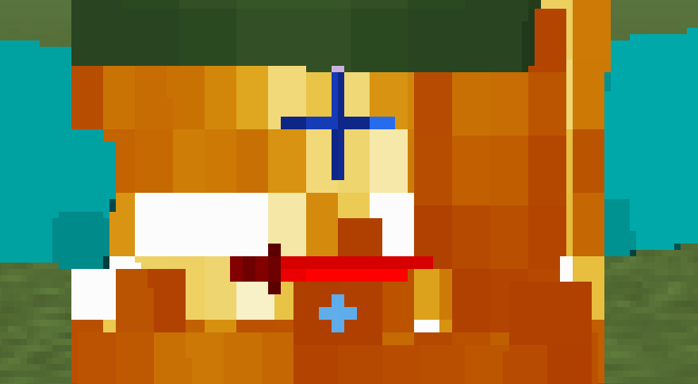

- Added config options
  - Added a config file under `config/quartermaster.json`. Has to be edited through a text editor, no mod menu is present
  - Enabled Weapons list
    - Decides which weapons get registered when the game starts and their tiers.
    - Relic, Bamboo and Tiered tiers can be turned on or off.
    - Tiered and Bamboo Rapiers are turned off by default.
  - Disabled Enchantments
    - Unlike Enchancements, this only disables obtaining certain enchantments; not disabling them as a whole.
    - By default, any enchantments that were designed for Apostasy Season 2's pack *in specific* are disabled.
    - Explosive Kinectivity is also disabled due to it's griefy-ness.
  - Merge Frost
    - Whether "Frost aspect" should be merged with Frostbite from Enchancements.
  - Stun Effects
    - If disabled, replaces all of QM's stun effects with vannila counterparts (slowness, weakness)
    - With the new Pushed effect and the many new ways to get Stunned this update, this may be a good option if you want more movement.
  - The default config file is as goes:
    ```json5
    {
    "//comment_1": "IMPORTANT NOTE: This config file should be synced between client and server! It's not *nessecary*, but will cause desync and break mods like Flashback!",
    "//comment_2": "Allows you to disable weapons, or certain tiers of weapons.",
    "enabledWeapons": [
    {
    "name": "morningstar",
    "tiered": true,
    "relic": true,
    "bamboo": true
    },
    {
    "name": "cutlass",
    "tiered": true,
    "relic": true,
    "bamboo": true
    },
    {
    "name": "warhammer",
    "tiered": true,
    "relic": true,
    "bamboo": true
    },
    {
    "name": "sickle",
    "tiered": true,
    "relic": true,
    "bamboo": true
    },
    {
    "name": "rapier",
    "tiered": false,
    "relic": true,
    "bamboo": false
    },
    {
    "name": "greataxe",
    "tiered": true,
    "relic": true,
    "bamboo": true
    },
    {
    "name": "estoc",
    "tiered": true,
    "relic": true,
    "bamboo": true
    }
    ],
    "//comment_3": "Which enchants should be registered. If you want to disable enchants from the base game or other mods, I would reccomend using Enchancements rather than this.",
    "//comment_4": "The default disabled enchant list is mostly enchants which only fit for the Apostasy Season 2 modpack. And explosive kinectivity.",
    "//comment_5": "Does not fully disable the enchant (like enchancements), but makes it unobtainable in survival.",
    "disabledEnchants": [
    "quartermaster:impact_protection",
    "quartermaster:magic_protection",
    "quartermaster:frost_protection",
    "quartermaster:bladedance",
    "quartermaster:singlehanded",
    "quartermaster:explosive_kinectivity"
    ],
    "//comment_6": "If Frost Aspect should be replaced with Enchancement's Frostbite",
    "mergeFrost": false,
    "//comment_7": "This can be disabled if the PvP style you're going for is much more reliant on movement",
    "//comment_8": "Replaces Stunned with Slowness and Disarmed with Weakness",
    "stunEffects": true
    }
    ```
  
- Added Tiered Rapiers
  - All of the Relic Rapier's stats have not changed
  - Weaker tiers return less damage to the attacker, but can be held for longer; making it easier to parry multiple attacks.
    - Relic and Netherite Rapiers do extra return damage, otherwise scaling between tiers is linear.
  - Mobs can now spawn with tiered rapiers, having a 25% chance to return attacks.
  - All rapiers go on a global cooldown when used.
- Added Sickles
  - Inspired by [Infernum Effugium's](https://modrinth.com/project/oewi3keo) Bedrock Sickles.
  - Has a very fast base attack speed alongside good damage output
  - Does less damage and less knockback dependant on how far away you are from the target. Closer = better
  - Adds an indicator to mark how range affects your damage.
  
    
- Reworked Elemental Enchants
  - Tidal Chill, Hellfork, Glacial, Heatwave and Earthquake have been removed.
  - Flame can now be applied to tridents and crossbows (elemental ranged weapons as a whole).
  - Tridents on fire now set hit entities on fire.
  - New weapon tag: "Elemental Weapons" and "Elemental Ranged Weapons"
    - Non-ranged contains nearly every item in the game that can be used for base melee combat. Axes, Swords, Spears and all QM weapons
    - Ranged contains any enchantable ranged weapon; including Bows, Crossbows, Tridents, and anything under the "#enchantable/bow" tag (for modd compatibility).
  - Frost Aspect added
    - Works similar to Enchancement's frostbite (and can be merged with said enchant with the config.)
    - Applies 300 ticks of Frozen Ticks to a player when hit.
    - Can be applied to any melee elemental weapon
  - Chill changed
    - Can now be applied to any ranged elemental weapon.
  - Earth Aspect Added
    - Can only be applied to Heavy weapons.
    - Replaces the ability of Heavy weapons with a stun; usually nullifying their usual damage or ability.
      - Greataxe: Projectile now stuns
      - Morningstar: Stun on hit dependant on fall distance
      - Warhammer: Stun on slam
      - Spear jabs no longer do damage, but now give Pushed
      - Axes cannot have Earth Aspect.
- New Effect: Pushed
  - Heavily reduces movement input's influence on movement
  - If your velocity greatly decreases in one tick (aka; you hit a wall), you take damage proportional to the speed you were going at.
  - PS. you can now have three different stun effects applied at once. C:
- Stunned and Disarmed's HUD effects now automatically find their maximum time, rather than using set values
- Fixed crashing in 26.1 (Searchies)
- Wounded shortened and made weaker (Searchies)
- Cutlass Enchant "Fling" now takes one more hit to enable, disarm time is no longer shortened (Searchies)

(Notable) Internal Changes
- Weapons
  - An object storing all tiered, bamboo and relic variations of an item, alongside with a class.
  - 3 Classes;
    - Light
    - Heavy
    - Ranged (unused)
  - These classes automatically place items into tags that right now control what items can have Earth Aspect or what items Mobs can spawn with naturally
- Disarmed, Stunned and Pushed's HUD effects are now done through one HUD element that can add any effect.